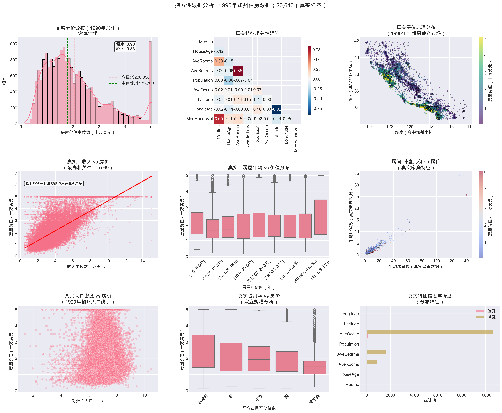
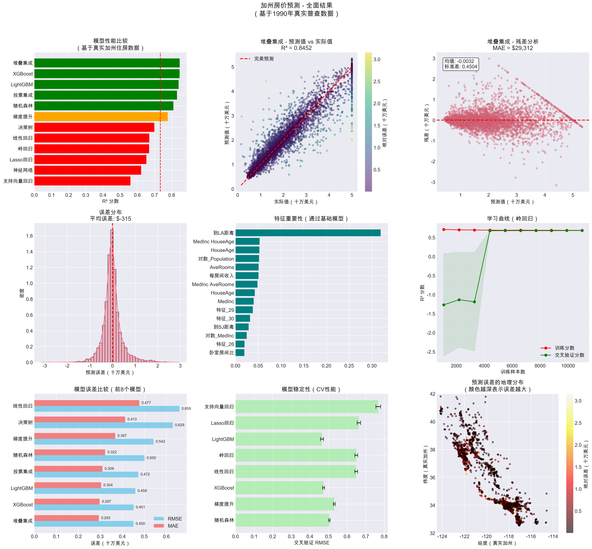

# California Housing Price Prediction (Machine Learning)

An end-to-end Machine Learning project that predicts the median house value for California districts using the 1990 California Census data. This project covers the complete ML lifecycle: Exploratory Data Analysis (EDA), Domain-Specific Feature Engineering, Multi-Model Evaluation, Stacking Ensemble, and Model Deployment.

> **⚠️ Important Note:** 
> Due to GitHub's file size limits, some large model files (`.pkl`) were omitted during the final commit. However, the entire pipeline is fully reproducible. Running `code.py` will automatically re-train the models and generate the `.pkl` files in your local environment.

---

## 📋 Table of Contents

- [Overview](#-overview)
- [Dataset Information](#-dataset-information)
- [Feature Engineering & Methodology](#-feature-engineering--methodology)
- [Model Performance](#-model-performance)
- [Key Insights](#-key-insights)
- [Screenshots](#-screenshots)
- [How to Run](#-how-to-run)
- [Technologies Used](#-technologies-used)
- [Author](#-author)

---

## 📖 Overview

Real estate valuation is crucial for economic analysis and investment. Traditional methods rely heavily on subjective human appraisal. This project demonstrates how Machine Learning can automate this process by finding complex, non-linear patterns in geographical and socio-economic data.

The final model is a **Stacking Ensemble** that achieved an **R² score of 0.845** and a **Mean Absolute Error (MAE) of ~$29,312**, outperforming traditional baseline models significantly.

---

## 📊 Dataset Information

- **Source**: 1990 California Census (available via `scikit-learn`).
- **Samples**: 20,640 block groups.
- **Features**: 8 original features (e.g., Median Income, House Age, Average Rooms, Location).
- **Target**: `MedHouseVal` (Median house value in 100,000s). Note: Values are capped at $500,000.

---

## 🧠 Feature Engineering & Methodology

To maximize model performance, the following domain-specific techniques were applied:

1. **Log Transformation**: Applied to skewed features (Income, Population, Occupancy) to reduce the impact of extreme outliers.
2. **Geographical Features**: Calculated Euclidean distances from each block to the coast and major cities (LA, SF, SD, SJ) to capture the "coastal premium" effect.
3. **Ratio Features**: Created `Income Per Room` and `Bedroom Ratio` to reflect housing efficiency.
4. **Robust Scaling**: Applied `RobustScaler` to non-geographical features to handle outliers using median and Interquartile Range (IQR) instead of mean and variance.
5. **No Data Leakage**: The dataset was split into Train/Test (80/20) **before** any preprocessing or feature scaling was applied.

---

## 🏆 Model Performance

Over 10 algorithms were tested, including Linear Models, Tree-based models, XGBoost, LightGBM, and Neural Networks. The **Stacking Ensemble** (combining Random Forest, Gradient Boosting, and XGBoost, with Linear Regression as the meta-learner) yielded the best results.

| Model | Test R² | Test RMSE (100k) | Test MAE (100k) | Percent Error |
| :--- | :--- | :--- | :--- | :--- |
| **Stacking Ensemble** | **0.8452** | **0.4504** | **0.2931** | **16.8%** |
| XGBoost | 0.8447 | 0.4511 | 0.2970 | 17.0% |
| LightGBM | 0.8392 | 0.4591 | 0.3036 | 17.3% |
| Voting Ensemble | 0.8297 | 0.4724 | 0.3093 | 17.5% |
| Random Forest | 0.8089 | 0.5005 | 0.3219 | 18.1% |

---

## 💡 Key Insights

1. **Income is King**: Median Income (`MedInc`) has the highest correlation with house value (r = 0.69). It is the most dominant predictor.
2. **Coastal Premium**: Geographical location strongly dictates price. Properties near the coast or major cities (LA, SF) are significantly more expensive.
3. **Model Stability**: 5-Fold Cross-Validation confirmed the Stacking model is robust, with very low variance across different data splits.

---

## 📸 Screenshots

### 1. Exploratory Data Analysis (EDA)
Shows the target distribution, correlation matrix, geographical spread, and feature relationships.



### 2. Model Results & Evaluation
Shows model comparison, actual vs. predicted values, residual analysis, feature importance, and geographical error distribution.



---

## 🚀 How to Run

### Prerequisites
Ensure you have Python installed, then install the required dependencies:
```bash
pip install numpy pandas matplotlib seaborn scikit-learn xgboost lightgbm
```

### Execution
1. Clone the repository.
2. Run the main script to train the models, generate artifacts, and create visualizations:
   ```bash
   python code.py
   ```
3. The script will automatically download the dataset via `scikit-learn`, train the models, and generate the `.pkl` files in your local environment.

---

## 🛠 Technologies Used

- **Python 3.9+**
- **Data Manipulation**: `pandas`, `numpy`
- **Machine Learning**: `scikit-learn`, `xgboost`, `lightgbm`
- **Data Visualization**: `matplotlib`, `seaborn`
- **Model Persistence**: `joblib`, `pickle`

---

## 👤 Author

**MARCELLA**
- Institution: Shantou University
- Major: Data Science and Big Data Technology
- Course: Machine Learning

---

## 📄 License

This project is created for educational purposes as part of the Machine Learning course final project.
